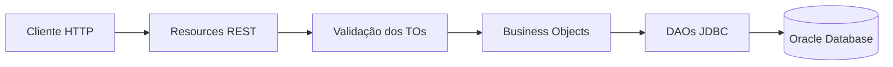

# Soulie — API Java

API REST desenvolvida para o projeto Soulie. O serviço organiza usuários, jornadas, missões, atividades, conquistas, comunidades e publicações. A aplicação foi construída com Java e Spring Boot, usa Oracle Database e pode ser executada localmente ou em um container Docker.

<p align="center">
  <a href="https://soulie-java.onrender.com">API publicada</a>
  ·
  <a href="https://github.com/EnzoNukui/soulie-java">Repositório</a>
</p>

## Índice

- [Visão geral](#visão-geral)
- [Tecnologias e organização](#tecnologias-e-organização)
- [Executar localmente](#executar-localmente)
- [Executar com Docker](#executar-com-docker)
- [Configuração do banco](#configuração-do-banco)
- [Referência da API](#referência-da-api)
- [Modelos e validações](#modelos-e-validações)
- [Exemplos de requisição](#exemplos-de-requisição)
- [Respostas HTTP](#respostas-http)

## Visão geral

A API oferece operações para manter os dados principais da aplicação e as relações entre eles. Os endpoints recebem e retornam JSON. Os códigos das entidades são gerados pelo Oracle; por isso, não devem ser informados nos corpos de criação.

### Recursos disponíveis

| Grupo | O que representa |
| --- | --- |
| Usuários | Conta e dados básicos do usuário |
| Avatares e streaks | Avatar e sequência de atividade de um usuário |
| Missões e atividades | Missões, participação e registros de atividade |
| Conquistas | Catálogo de conquistas e conquistas vinculadas a usuários |
| Comunidades e postagens | Comunidades, participações e publicações |

## Tecnologias e organização

- Java 21
- Spring Boot e Spring Web MVC
- Bean Validation para validar os corpos das requisições
- JDBC com driver Oracle (`ojdbc17`)
- Maven Wrapper para compilar e executar o projeto
- Docker com a imagem Eclipse Temurin 21 Alpine

O código está separado por responsabilidade: `resource` recebe as requisições HTTP, `bo` concentra as operações de negócio, `dao` acessa o Oracle e `to` define os objetos transferidos pela API.



## Executar localmente

### Requisitos

- JDK 21
- Acesso a um banco Oracle com o esquema do projeto

Configure as três variáveis de ambiente usadas pela `ConnectionFactory` antes de iniciar a aplicação. No PowerShell:

```powershell
$env:DB_URL = "jdbc:oracle:thin:@//HOST:1521/SERVICE_NAME"
$env:DB_USER = "USUARIO"
$env:DB_PASSWORD = "SENHA"
.\mvnw.cmd spring-boot:run
```

Substitua `HOST`, `SERVICE_NAME`, usuário e senha pelos dados do seu banco. A aplicação inicia na porta `8080`.

Para gerar o JAR manualmente:

```powershell
.\mvnw.cmd -DskipTests clean package
java -jar target/soulie-0.0.1-SNAPSHOT.jar
```

## Executar com Docker

Com o Docker Engine iniciado, execute os comandos na raiz do projeto:

```powershell
docker build -t soulie:local .
docker run --rm -p 8080:8080 `
  -e DB_URL="jdbc:oracle:thin:@//HOST:1521/SERVICE_NAME" `
  -e DB_USER="USUARIO" `
  -e DB_PASSWORD="SENHA" `
  soulie:local
```

O `Dockerfile` compila a aplicação dentro da imagem e inicia o JAR `soulie-0.0.1-SNAPSHOT.jar`. Não versione senhas ou credenciais; no Render, configure `DB_URL`, `DB_USER` e `DB_PASSWORD` nas variáveis de ambiente do serviço.

## Configuração do banco

Os scripts Oracle estão na pasta [`database`](database/):

- `Soulie_Sprint4_Oracle.sql`: criação das tabelas e restrições do esquema.
- `Soulie_Sprint4_Migracao_Oracle.sql`: script de migração do banco.

As chaves primárias das entidades são geradas pelo banco com `GENERATED ALWAYS AS IDENTITY`. As tabelas de relacionamento usam chaves compostas, formadas pelos códigos das entidades relacionadas.

## Referência da API

### Endereço base

| Ambiente | URL |
| --- | --- |
| Local | `http://localhost:8080` |
| Render | [`https://soulie-java.onrender.com`](https://soulie-java.onrender.com) |

Os caminhos abaixo são relativos ao endereço base. Por exemplo, `GET /usuarios/12` no Render corresponde a `https://soulie-java.onrender.com/usuarios/12`.

### Usuários — `/usuarios`

| Método | Caminho | Descrição |
| --- | --- | --- |
| `GET` | `/usuarios` | Lista os usuários |
| `GET` | `/usuarios/{idUsuario}` | Busca pelo código |
| `GET` | `/usuarios/email?email={email}` | Busca pelo endereço de e-mail |
| `GET` | `/usuarios/jornada/{identificadorJornada}` | Busca uma jornada pelo identificador |
| `POST` | `/usuarios` | Cadastra um usuário |
| `PUT` | `/usuarios/{idUsuario}` | Atualiza nome e e-mail |
| `DELETE` | `/usuarios/{idUsuario}` | Exclui um usuário |

### Avatares — `/avatares`

| Método | Caminho | Descrição |
| --- | --- | --- |
| `GET` | `/avatares` | Lista os avatares |
| `GET` | `/avatares/{idAvatar}` | Busca pelo código |
| `GET` | `/avatares/usuario/{idUsuario}` | Busca o avatar de um usuário |
| `PUT` | `/avatares/{idAvatar}` | Atualiza o temperamento; usuário e evolução são preservados |

### Streaks — `/streaks`

| Método | Caminho | Descrição |
| --- | --- | --- |
| `GET` | `/streaks` | Lista os streaks |
| `GET` | `/streaks/{idStreak}` | Busca pelo código |
| `GET` | `/streaks/usuario/{idUsuario}` | Busca o streak de um usuário |

### Missões — `/missoes`

| Método | Caminho | Descrição |
| --- | --- | --- |
| `GET` | `/missoes` | Lista as missões |
| `GET` | `/missoes/{idMissao}` | Busca pelo código |
| `POST` | `/missoes` | Cadastra uma missão de usuário; exige `idUsuarioCriador` |
| `PUT` | `/missoes/{idMissao}` | Atualiza uma missão de usuário; missões oficiais são gerenciadas pelo sistema |
| `DELETE` | `/missoes/{idMissao}` | Exclui missão de usuário sem participações; missões oficiais são preservadas |

### Participação em missões — `/usuario-missoes`

| Método | Caminho | Descrição |
| --- | --- | --- |
| `GET` | `/usuario-missoes/usuario/{idUsuario}` | Lista as missões de um usuário |
| `GET` | `/usuario-missoes/missao/{idMissao}` | Lista os usuários de uma missão |
| `GET` | `/usuario-missoes/{idUsuario}/{idMissao}` | Busca a relação entre usuário e missão |
| `POST` | `/usuario-missoes` | Registra a participação |
| `DELETE` | `/usuario-missoes/{idUsuario}/{idMissao}` | Remove participação sem atividades, se ainda estiver em andamento |

### Atividades — `/atividades`

| Método | Caminho | Descrição |
| --- | --- | --- |
| `GET` | `/atividades` | Lista as atividades |
| `GET` | `/atividades/{idRegistro}` | Busca pelo código do registro |
| `GET` | `/atividades/usuario/{idUsuario}` | Lista as atividades de um usuário |
| `GET` | `/atividades/missao/{idMissao}` | Lista as atividades de uma missão |
| `POST` | `/atividades` | Registra uma atividade |
| `PUT` | `/atividades/{idRegistro}` | Atualiza uma atividade |
| `DELETE` | `/atividades/{idRegistro}` | Exclui uma atividade |

### Conquistas — `/conquistas`

| Método | Caminho | Descrição |
| --- | --- | --- |
| `GET` | `/conquistas` | Lista as conquistas |
| `GET` | `/conquistas/{idConquista}` | Busca pelo código |
| `POST` | `/conquistas` | Cadastra uma conquista personalizada; nomes reservados são rejeitados |
| `PUT` | `/conquistas/{idConquista}` | Atualiza uma conquista personalizada; as automáticas são protegidas |
| `DELETE` | `/conquistas/{idConquista}` | Exclui uma conquista personalizada sem vínculos |

### Conquistas de usuários — `/usuario-conquistas`

| Método | Caminho | Descrição |
| --- | --- | --- |
| `GET` | `/usuario-conquistas/usuario/{idUsuario}` | Lista as conquistas de um usuário |
| `GET` | `/usuario-conquistas/conquista/{idConquista}` | Lista os usuários que receberam uma conquista |
| `GET` | `/usuario-conquistas/{idUsuario}/{idConquista}` | Busca a relação entre usuário e conquista |

### Comunidades — `/comunidades`

| Método | Caminho | Descrição |
| --- | --- | --- |
| `GET` | `/comunidades` | Lista as comunidades |
| `GET` | `/comunidades/{idComunidade}` | Busca pelo código |
| `POST` | `/comunidades` | Cadastra uma comunidade |
| `PUT` | `/comunidades/{idComunidade}` | Atualiza uma comunidade |
| `DELETE` | `/comunidades/{idComunidade}` | Exclui uma comunidade |

### Participação em comunidades — `/usuario-comunidades`

| Método | Caminho | Descrição |
| --- | --- | --- |
| `GET` | `/usuario-comunidades/usuario/{idUsuario}` | Lista as comunidades de um usuário |
| `GET` | `/usuario-comunidades/comunidade/{idComunidade}` | Lista os usuários de uma comunidade |
| `GET` | `/usuario-comunidades/{idUsuario}/{idComunidade}` | Busca a relação entre usuário e comunidade |
| `POST` | `/usuario-comunidades` | Registra a participação |
| `PUT` | `/usuario-comunidades/{idUsuario}/{idComunidade}` | Atualiza a participação |
| `DELETE` | `/usuario-comunidades/{idUsuario}/{idComunidade}` | Remove a participação |

### Postagens — `/postagens`

| Método | Caminho | Descrição |
| --- | --- | --- |
| `GET` | `/postagens` | Lista as postagens |
| `GET` | `/postagens/{idPostagem}` | Busca pelo código |
| `GET` | `/postagens/usuario/{idUsuario}` | Lista as postagens de um usuário |
| `GET` | `/postagens/comunidade/{idComunidade}` | Lista as postagens de uma comunidade |
| `POST` | `/postagens` | Publica uma postagem |
| `PUT` | `/postagens/{idPostagem}` | Atualiza uma postagem |
| `DELETE` | `/postagens/{idPostagem}` | Exclui uma postagem |

### Regras automáticas da jornada

- O cadastro de usuário cria, na mesma operação, o avatar inicial e o streak zerado. O sistema gera o identificador da jornada e inicia os pontos em zero.
- O usuário pode alterar nome e e-mail. Pontos, status e identificador da jornada são preservados pelo sistema.
- A exclusão do usuário remove avatar e streak na mesma transação. Se existirem outros registros vinculados, a operação é revertida para preservar esses dados.
- O registro de atividade usa a data atual do servidor. Ele atualiza o streak e, ao cumprir uma missão oficial, soma os pontos de recompensa à pontuação e à experiência do avatar.
- A experiência define o nível do avatar: 1 a partir de 0, 2 a partir de 100, 3 a partir de 250, 4 a partir de 450 e 5 a partir de 700.
- Uma missão é concluída ao atingir sua meta de dias distintos desde o início da participação. Missões criadas por usuários não concedem pontos nem experiência.
- Missões oficiais têm `idUsuarioCriador` nulo e são cadastradas diretamente pelo sistema. A API exige um criador para novas missões e não permite alterar missões oficiais.
- O cliente não pode editar o status ou as datas da participação. A exclusão só é permitida enquanto estiver em andamento e sem atividades registradas.
- As conquistas `Primeiros passos`, `Consistência`, `Semana sustentável`, `Compromisso verde` e `Soulie evoluída` são concedidas automaticamente ao cumprir seus critérios. O modelo Oracle foi mantido como está; por isso, os nomes dessas cinco conquistas são as referências usadas pelo código, ficam reservados e não devem ser alterados. Os scripts do projeto incluem esses registros.
- O feed geral e os feeds por usuário ou comunidade exibem as publicações mais recentes primeiro.
- Os endpoints de escrita de streak e de vínculo de conquista, além da criação e exclusão de avatar, são mantidos na API, mas as BOs rejeitam alterações manuais desses dados calculados ou vinculados à jornada.
- As rotas bloqueadas respondem com `400 Bad Request` para criação/atualização e `409 Conflict` para exclusões, com a explicação no corpo da resposta.

## Modelos e validações

Os campos `id...` que identificam entidades são gerados pelo Oracle no cadastro. Corpos de `POST` e `PUT` devem usar os nomes abaixo em camelCase. Os vínculos entre tabelas continuam exigindo os códigos relacionados.

| Modelo | Campos | Regras principais |
| --- | --- | --- |
| `UsuarioTO` | `idUsuario`, `nomeUsuario`, `email`, `pontosAcumulados`, `status`, `identificadorJornada` | Nome e e-mail obrigatórios; e-mail válido. Pontos, status e identificador são controlados pelo sistema |
| `AvatarTO` | `idAvatar`, `idUsuario`, `nivelEvolucao`, `experiencia`, `temperamento` | A criação ocorre junto com o usuário; nível e experiência são controlados pelas atividades |
| `StreakTO` | `idStreak`, `idUsuario`, `diasConsecutivos`, `dataUltimaAtividade` | Criado junto com o usuário; dias e data são calculados com base nas atividades |
| `MissaoTO` | `idMissao`, `nome`, `descricao`, `pontosRecompensa`, `idUsuarioCriador`, `metaDias` | Nome e descrição obrigatórios; pontos não negativos; `metaDias` positivo; criador obrigatório e válido na criação pela API |
| `UsuarioMissaoTO` | `idUsuario`, `idMissao`, `dataInicio`, `dataConclusao`, `status` | Usuário, missão e início obrigatórios; datas não futuras; status com até 15 caracteres |
| `AtividadeTO` | `idRegistro`, `idUsuario`, `idMissao`, `dataRegistro`, `observacao` | Usuário e missão obrigatórios; IDs positivos; data atribuída pelo servidor; observação até 200 caracteres |
| `ConquistaTO` | `idConquista`, `nome`, `descricao` | Nome obrigatório; nome até 70 e descrição até 80 caracteres |
| `UsuarioConquistaTO` | `idUsuario`, `idConquista`, `dataConquista` | Conquistas são atribuídas pelo sistema quando as regras são cumpridas |
| `ComunidadeTO` | `idComunidade`, `nome`, `tema` | Nome obrigatório (até 50 caracteres); tema até 90 caracteres |
| `UsuarioComunidadeTO` | `idUsuario`, `idComunidade`, `dataIngresso` | IDs positivos e data obrigatórios; data não futura |
| `PostagemTO` | `idPostagem`, `idUsuario`, `idComunidade`, `titulo`, `conteudo`, `dataPostagem` | IDs e data obrigatórios; título até 80 e conteúdo até 200 caracteres; data não futura |

Datas seguem o padrão ISO 8601: `LocalDate` usa `AAAA-MM-DD`; `LocalDateTime` usa `AAAA-MM-DDTHH:mm:ss`.

## Exemplos de requisição

### Cadastrar um usuário

```http
POST /usuarios
Content-Type: application/json
```

```json
{
  "nomeUsuario": "Enzo",
  "email": "enzo@example.com"
}
```

Em caso de sucesso, a resposta é `201 Created` e contém o usuário cadastrado, incluindo o código gerado pelo banco e o identificador de jornada criado pelo sistema. A API também cria o avatar e o streak iniciais na mesma operação. Pontos começam em zero e não são aceitos do cliente.

### Buscar usuário por e-mail

```http
GET /usuarios/email?email=enzo@example.com
```

### Criar uma missão

```json
{
  "nome": "Leitura diária",
  "descricao": "Leia por alguns minutos todos os dias.",
  "pontosRecompensa": 20,
  "idUsuarioCriador": 1,
  "metaDias": 7
}
```

### Registrar participação em missão

```json
{
  "idUsuario": 1,
  "idMissao": 2,
  "dataInicio": "2026-10-21",
  "dataConclusao": null,
  "status": "EM_ANDAMENTO"
}
```

### Registrar uma atividade

```json
{
  "idUsuario": 1,
  "idMissao": 2,
  "observacao": "Atividade concluída hoje."
}
```

A data do registro é definida pelo servidor. Ao salvar uma atividade, o sistema atualiza o streak, conclui a missão quando a meta de dias distintos é atingida, soma pontos e experiência de missões oficiais, calcula o nível do avatar e verifica as conquistas automáticas.

### Cadastrar uma conquista

```json
{
  "nome": "Primeiros passos",
  "descricao": "Concluiu a primeira missão."
}
```

### Criar uma comunidade

```json
{
  "nome": "Leitores FIAP",
  "tema": "Leitura e hábitos"
}
```

### Registrar participação em comunidade

```json
{
  "idUsuario": 1,
  "idComunidade": 3,
  "dataIngresso": "2026-10-21"
}
```

### Criar uma postagem

```json
{
  "idUsuario": 1,
  "idComunidade": 3,
  "titulo": "Minha primeira semana",
  "conteudo": "Consegui manter minha rotina durante a semana.",
  "dataPostagem": "2026-10-21T14:30:00"
}
```

Os exemplos de participação exigem que os códigos de usuário, missão ou comunidade já existam no banco. As datas informadas são ilustrativas e precisam ser iguais ou anteriores à data atual. Pontos, experiência, nível, streak e concessão de conquistas são mantidos pelas regras de negócio, sem edição manual por essas rotas.

## Respostas HTTP

| Código | Quando ocorre |
| --- | --- |
| `200 OK` | Consulta ou atualização concluída |
| `201 Created` | Registro criado; o corpo contém o objeto retornado pela API |
| `204 No Content` | Exclusão concluída |
| `400 Bad Request` | Corpo inválido na validação ou falha no cadastro/atualização |
| `404 Not Found` | Registro ou relação não encontrada |

Em consultas, o sucesso retorna `200 OK` com um objeto ou uma lista JSON. Em cadastros, `201 Created` retorna o objeto persistido. Atualizações respondem com `200 OK` e o objeto atualizado. Exclusões respondem com `204 No Content`; clientes devem considerar essa resposta sem corpo. Quando o recurso não existe, a API responde `404 Not Found`. Corpos que não passam pela validação recebem `400 Bad Request`.

As mensagens de erro produzidas pelas resources estão em português. O formato exato do erro de validação é o padrão do Spring Boot.
